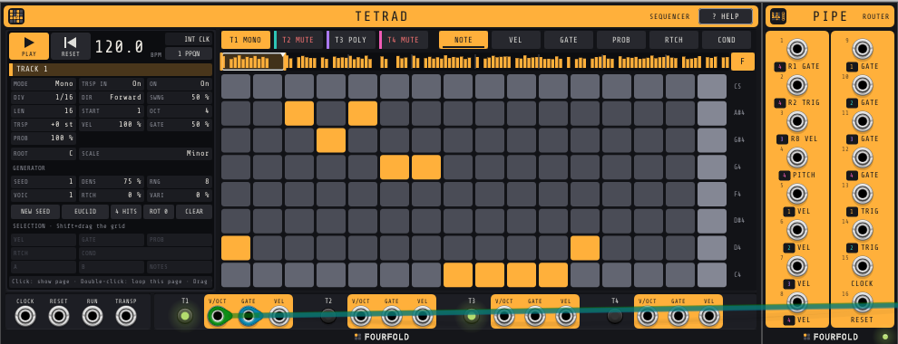
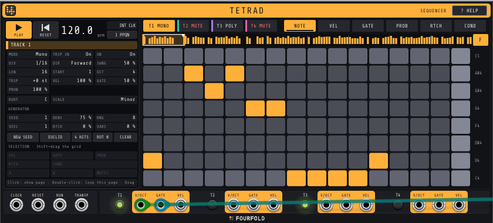
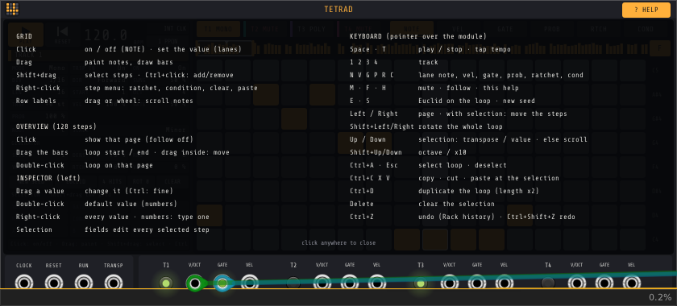
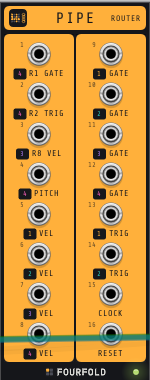

# Fourfold

  

[VCV Rack 2](https://vcvrack.com) plugin: Tetrad, a four-track step sequencer, and Tetrad Pipe,
its routing expander.



| Module | Width | Role |
|---|---|---|
| **Tetrad** | 56 HP | Four tracks of up to 128 steps, edited on a 16x8 grid, with an inspector for every setting |
| **Tetrad Pipe** | 10 HP | 16 outputs, each routed by right-click to any signal of any track |

## Features

- Four tracks, Mono (one note per step) or Poly (up to 7 notes per step).
- 128 steps per track (8 pages of 16), with a loop window (start + length) that can wrap.
- Steps hold scale degrees: changing the root or the scale re-harmonises the pattern.
  29 scales.
- Per step: notes, velocity, gate (up to a tie), probability, ratchets (x1 to x8) and trig
  conditions (A:B, not A:B, first loop, PRE, not PRE).
- Per track: division (1/1 to 1/64, triplets), direction (forward, backward, ping-pong, random,
  drunk), swing, octave, transpose, velocity / gate / probability scaling.
- Generator: seed, density, range, voices, ratchet and condition amounts; Euclidean fill.
- Loop tools: expand, condense, flip, rotate, duplicate, clear.
- Internal clock (20 to 300 BPM, tap tempo) or external clock (1 to 48 PPQN).
- Every edit goes through Rack's undo history.

## Interface



The left half is an **inspector**: transport, the selected track's settings, root and scale,
the generator, and the fields of the selected steps. The right half holds the track and lane
tabs, an overview of the 128 steps with the loop handles, the 16x8 grid and the note names of
the rows. A help line at the bottom of the inspector describes what is under the pointer, and
the **HELP** button (in the name band, or key `H`) shows every gesture and shortcut. PLAY and RESET
are the two large buttons at the top left of the inspector.

### Mouse

| Where | Gesture | Effect |
|---|---|---|
| Grid | click | NOTE lane: note on / off. Other lanes: set the value at the clicked height |
| | drag | paint notes or bars; the first pad decides between drawing and erasing |
| | Shift+drag | select steps (Shift+click extends the selection) |
| | Ctrl+click | add or remove one step from the selection |
| | right-click | step menu: select, toggle, ratchet, condition, clear, paste, loop tools |
| Note names | drag or wheel | scroll the visible notes |
| Overview | click | show that page (turns Follow off) |
| | double-click | loop on that page |
| | drag a handle / the inside | move the loop start or end / move the loop |
| Inspector | drag a number | change it (Ctrl: fine) |
| | double-click a number | default value |
| | click a list or a switch | open the list / toggle |
| | right-click | every value; numbers also get a slider and a text entry |
| Tempo | drag · double-click | change (Ctrl: 0.1 BPM) · 120 BPM |

With steps selected, the selection fields (VEL, GATE, PROB, RTCH, COND, A, B, NOTES) edit
every selected step at once. When the selected steps differ, the field shows a range
(`64-100`) and a drag moves every value by the same amount.

### Keyboard

Shortcuts work while the pointer is over the module. Letters follow the keyboard layout;
digits and arrows use their position. Without a selection, Delete and Ctrl+C keep their Rack
meaning (delete or copy the module).

| Key | Action |
|---|---|
| Space · T | play / stop · tap tempo |
| 1 2 3 4 | select a track |
| N V G P R C | lane: note, velocity, gate, probability, ratchet, condition |
| M · F · H | mute the track · follow the playhead · help |
| E · S | Euclidean fill of the loop · new generator seed |
| Left / Right | previous / next page; with a selection: move the selected steps |
| Shift+Left / Shift+Right | rotate the loop |
| Up / Down | with a selection: transpose (NOTE) or change the lane value; otherwise scroll notes |
| Shift+Up / Shift+Down | by an octave / by 10 |
| Page Up / Page Down | previous / next page |
| Ctrl+A · Esc | select the loop · clear the selection |
| Ctrl+C · Ctrl+X · Ctrl+V | copy · cut · paste at the selection |
| Ctrl+D | duplicate the loop after itself and double its length |
| Delete | clear the selected steps |
| Ctrl+Z · Ctrl+Shift+Z | undo · redo (Rack history) |

Arrow keys and Page Up / Page Down repeat when held. Over Tetrad, arrows act on the module and
the rack view stays still; elsewhere they scroll the rack as usual.

### Loop tools

In the step menu and the module menu, applied to the loop of the selected track:

| Tool | Effect |
|---|---|
| Expand | spreads the steps to every other step, doubles the length and halves the division: same music, twice the resolution |
| Condense | the reverse: keeps every other step, halves the length, doubles the division |
| Flip | reverses the step order |
| Rotate left / right | shifts the steps by one inside the loop |
| Duplicate | copies the loop after itself and doubles its length |
| Euclid | spreads HITS pulses over the loop, rotated by ROT, on the bottom visible row |
| Clear | turns every step of the loop off |



## Jacks and clock

| Jack or control | Role |
|---|---|
| PLAY | play / stop (lit green while playing, on by default). Stop goes back to step 1 |
| RESET | back to step 1 |
| CLOCK | external clock at the selected PPQN (1, 2, 4, 8, 12, 24, 48; default 1). Unpatched: internal clock at the inspector tempo |
| RESET | rising edge: back to step 1 |
| RUN | high: play, low: pause; unpatched: follows PLAY |
| TRANSP | 1 V/oct, rounded to semitones, added to the tracks with TRSP IN on |
| T1 to T4 | track on / off |
| V/OCT, GATE, VEL | per track: 0 V = C4; 10 V gates; velocity 0 to 10 V. Polyphonic in Poly mode (up to 7 channels) |

Most Rack clock modules send one pulse per quarter note on their main output, which is the
default resolution. Click the PPQN field of the inspector to change it. Over an external
clock, a step that falls on a pulse fires exactly with it, even when the clock slows down; the
transport stops after four periods without a pulse.

## Tetrad Pipe



Place the Pipe directly to the right of Tetrad; its light shows the link. Each of its 16
outputs is routed by right-click:

| Menu | Choices |
|---|---|
| Signal | None, Pitch (V/oct, poly), Velocity (poly), Gate (poly), Trigger (1 ms per note), Row gate, Row trigger, Row velocity, Clock, Reset |
| Track | 1 to 4 |
| Row | 1 (bottom grid row) to 8 |

A Poly track works as a drum track: each grid row (scale degrees 0 to 7 at the default scroll)
has its own gate, trigger and velocity. "Route a track as drums" in the module menu sends the
velocities of rows 1-8 of a track to outputs 1-8 and their gates to outputs 9-16. The default
routing is pitch, velocity and gate of the four tracks on outputs 1-12, triggers of tracks 1
and 2, clock and reset. The Pipe adds one sample of latency (Rack expander messages).

## Building

Requirements: the [Rack SDK](https://vcvrack.com/manual/Building#Building-Rack-plugins) 2.x,
a C++17 compiler, `make` and `jq`.

```bash
make RACK_DIR=/path/to/Rack-SDK          # plugin.so
make RACK_DIR=/path/to/Rack-SDK test     # core unit tests
make RACK_DIR=/path/to/Rack-SDK dist     # dist/Fourfold-<version>-<arch>.vcvplugin
make RACK_DIR=/path/to/Rack-SDK install  # copies the package into the Rack user folder
```

## Source layout

| Path | Content |
|---|---|
| `core/` | sequencer engine, patterns, parameters, scales, grid model, editing operations, clock follower and CV voices, pattern save format. No Rack dependency |
| `src/Tetrad.*` | the Tetrad module: transport, parameter and pattern exchange with the UI, outputs |
| `src/TetradWidget.cpp`, `Inspector.*`, `GridPanel.*`, `Actions.cpp`, `ui.hpp` | the Tetrad panel, keyboard shortcuts, menus and undo |
| `src/Pipe.cpp`, `pipe.hpp` | the Pipe expander |
| `tests/core_tests.cpp` | unit tests of the core |
| `docs/DESIGN.md` | interface principles, performance notes, roadmap |

Threads: the engine thread owns the sequencer. The UI edits a shared copy of the patterns under
a mutex that the engine only takes with `try_lock`, every 32 samples. Patterns are saved in the
patch as a small text document (`core/state.h`); parameters are regular Rack parameters.

## License

[GPL-3.0-or-later](LICENSE).
